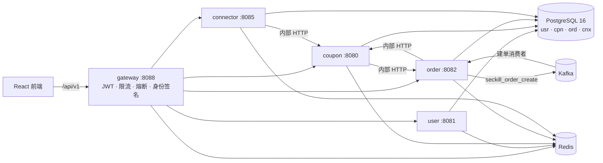

# CouponKill

高并发优惠券秒杀系统：Go 后端（网关 + 四个业务服务）、React 前端，Kubernetes 原生部署。

秒杀的核心是**不超卖、不重复、不丢单**——库存预扣、异步落单、超时对账和取消回补都有明确的不变式，并由并发、重放、崩溃注入的测试和端到端测试证明。设计与不变式见 [`docs/ARCHITECTURE.md`](docs/ARCHITECTURE.md)。

## 架构



| 服务 | 职责 |
|---|---|
| gateway | 反向代理、JWT 校验与按令牌吊销、签名身份头、每 IP/用户/秒杀限流、按上游熔断、路径规范化 |
| user | 注册、登录、登出、资料；口令 bcrypt，登录对未知用户做等价计算防枚举 |
| coupon | 券与分桶库存；`stock_ledger` 让扣减/归还对同一 `requestId` 严格幂等且崩溃安全 |
| order | 秒杀入口（Lua 预扣 → Kafka）、幂等建单消费者、超时对账、订单、预约帮抢、站内通知 |
| connector | 电商平台（JD/PDD/TB/mock）的 SKU 绑定、同品比价、库存同步（只降不升） |

## 秒杀流程

```
POST /api/v1/order/seckill ──► 校验券时间窗 ──► Redis Lua 预扣（占位 + 计数）──► Kafka ──► 202 {requestId}
                                                                                     │
前端轮询 GET /seckill/result ◄── Redis 请求状态 ◄── 建单消费者：coupon 扣库存（幂等）→ 单事务落单 + 通知
                                                         └── 超时未决的请求由 sweeper 对账（有单则成功，无单则归还）
```

任何一步都可能重放或崩溃，所以每一步都幂等；预扣计数 + 在途请求 + 已成功订单恒等于初始库存。

## 快速开始

需要：Go 1.27、Node 22、PostgreSQL 16（Redis 与 Kafka 可用 Docker，也可用内存替身）。

**有 Docker：**

```bash
cp .env.example .env
docker compose up -d                       # PostgreSQL 5433 / Redis 6379 / Kafka 9092（含主题初始化）
docker compose --profile app up -d --build # 再加上五个服务
```

**没有 Docker**（Redis/Kafka 用 `cmd/devinfra` 的内存替身，PostgreSQL 自备）：

```bash
go run ./cmd/devinfra -redis 127.0.0.1:6379 -kafka-port 9092 &
export CK_PG_DSN='postgres://postgres@127.0.0.1:5432/couponkill?sslmode=disable' CK_SEED_DEMO=true
for s in user coupon order connector gateway; do go run ./cmd/$s & done
```

服务启动时会自己执行各自 schema 的迁移。`CK_SEED_DEMO=true` 写入演示数据：用户 `demo` / `demo1234`、管理员 `admin` / `admin1234`、秒杀券 1001 与常驻券 1002（生产环境禁止，`CK_ENV=prod` 下会直接启动失败）。

```bash
cd frontend/couponkill-frontend && npm ci && npm run dev   # http://localhost:5173，/api 代理到网关 :8088
```

配置全部是环境变量（`CK_*`），每个服务的变量、端点和运行方式见 `internal/<service>/README.md`，公共部分见 [`internal/platform/README.md`](internal/platform/README.md)。

## 测试

```bash
export CK_TEST_PG_DSN='postgres://postgres@127.0.0.1:5432/postgres?sslmode=disable'   # 需要能建库的账号；每个测试自建并删除临时库
export CK_REQUIRE_PG=true                                                              # 没有数据库时失败而不是跳过
go vet ./cmd/... ./internal/... ./test/... && go test -count=1 ./cmd/... ./internal/... ./test/...

scripts/e2e-local.ps1        # 一条命令端到端：自建临时库 + 内存替身 + 五个真实服务进程 + test/e2e
cd frontend/couponkill-frontend && npm run lint && npm test && npm run build
cd charts/couponkill/tests/render && go test ./... && helm lint charts/couponkill
```

没有 gcc 的机器无法运行 `-race`，CI 里会加上；并发相关的测试用 `-count=20` 重复运行代替。

## 部署

- 镜像：[`build/Dockerfile`](build/Dockerfile)，`--build-arg SERVICE=<gateway|user|coupon|order|connector>`，运行在 `distroless/static:nonroot`。
- Kubernetes：[`charts/couponkill`](charts/couponkill)（Helm），说明见其 README；生产需要预先创建 Secret `couponkill-app-secrets`，**不要把任何真实凭证提交进仓库**。
- Istio 叠加层：[`k8s-istio`](k8s-istio)（只暴露 gateway，STRICT mTLS，按服务账户授权）。
- CD 见 [`Jenkinsfile`](Jenkinsfile)，PR 校验见 [`.github/workflows/ci.yml`](.github/workflows/ci.yml)。

## 目录

```
cmd/                 各服务入口（只做装配）与 devinfra（开发替身）
internal/platform/   共享基础设施：配置、日志、HTTP、鉴权、DB、Redis、Kafka、限流熔断、生命周期、测试工具
internal/contracts/  跨服务契约：Redis 键、Kafka 载荷、内部 API 与客户端
internal/<service>/  各服务：handler → service → repo，以及自己 schema 的 migrations
test/e2e/            对真实服务进程的端到端测试
frontend/            React 前端（couponkill-miniprogram 为旧契约的小程序，未维护）
couponkill-operator/ Kubernetes Operator（独立 Go 模块）
charts/ build/ k8s-istio/ docker-compose.yml   交付与部署
```
